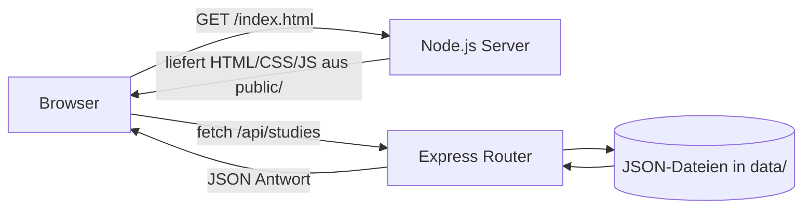

# Clinical Study Finder

Kleine Webseite, mit der Ärzte und Studienärzte offene klinische Studien im Bereich Gastroenterologie finden können. Man wählt eine Kategorie (CED, Leber, Ösophagus), bekommt die passenden Studien angezeigt und kann sich Details dazu anschauen.

Details zu den geplanten Funktionen stehen in [SPEC.md](SPEC.md), die Ordnerstruktur in [PROJECT_STRUCTURE.md](PROJECT_STRUCTURE.md).

## Installation

Voraussetzung: Node.js (am besten Version 18 oder neuer). Prüfen mit:

```
node -v
```

Falls nichts ausgegeben wird, Node.js von https://nodejs.org installieren.

Danach im Projektordner:

```
npm install
npm start
```

Die Seite läuft dann unter http://localhost:3000

## Port ändern

Der Port steht fest in [server/server.js](server/server.js), Zeile 7:

```
const port = 3000;
```

Einfach die Zahl ändern und Server neu starten. Läuft schon etwas anderes auf Port 3000, hier einen freien Port eintragen, z. B. 3001.

## Im Netzwerk erreichbar machen

Standardmäßig lauscht der Server auf allen Netzwerkschnittstellen, nicht nur auf `localhost`. Andere PCs im selben Netzwerk (z. B. gleiches WLAN) können also zugreifen, wenn man die lokale IP-Adresse des Rechners kennt, auf dem der Server läuft.

IP-Adresse herausfinden (in der Eingabeaufforderung):

```
ipconfig
```

Die Adresse hinter "IPv4-Adresse" notieren, z. B. `192.168.1.50`. Andere Geräte rufen die Seite dann über

```
http://192.168.1.50:3000
```

auf, statt über `localhost`.

Zwei Dinge, die noch blockieren können:

- Die Windows-Firewall fragt beim ersten Start meist automatisch, ob Node.js im privaten Netzwerk erlaubt werden soll - das muss bestätigt werden. Falls nicht, in der Windows-Firewall eine Regel für eingehende Verbindungen auf dem verwendeten Port (z. B. 3000) anlegen.
- Beide Rechner müssen im selben Netzwerk sein (z. B. gleiches WLAN, kein Gäste-WLAN mit Client-Isolation).

## Wie das Ganze zusammenhängt

Der Browser lädt nur statische Dateien aus `public/` (HTML, CSS, JS). Alles was mit Daten zu tun hat - Studien laden, Login, Studien speichern - läuft über eine kleine Node.js/Express API im Ordner `server/`. Die Daten selbst liegen als JSON-Dateien unter `data/`.



Kurz gesagt: Express nimmt Anfragen vom Browser entgegen, schaut in den passenden JSON-Dateien nach (z. B. `data/Studies/`) und schickt das Ergebnis zurück. Es gibt keine Datenbank, nur Dateien.

## Projektstruktur

Siehe [PROJECT_STRUCTURE.md](PROJECT_STRUCTURE.md) für die genaue Aufteilung der Ordner.
